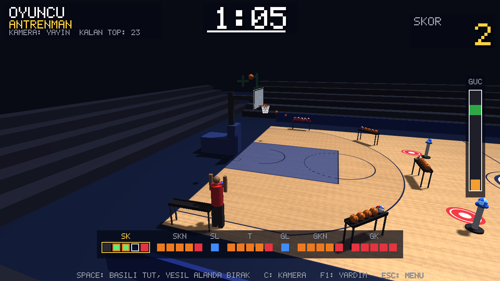
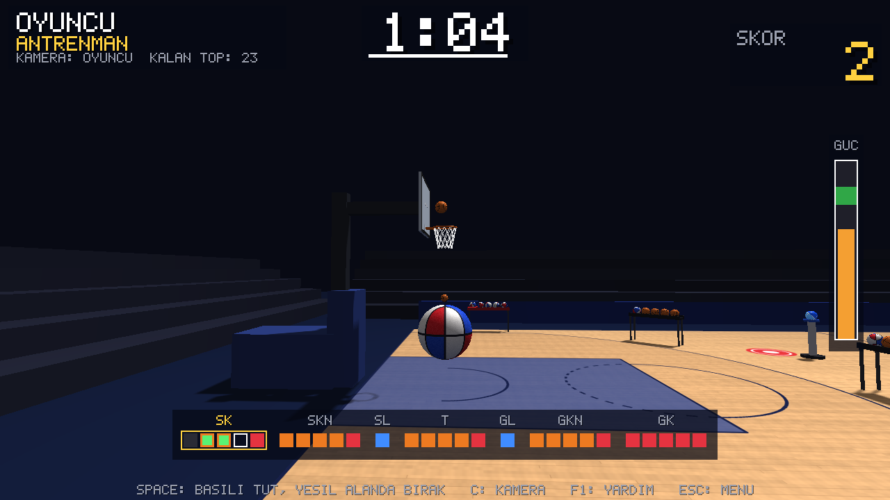

# 3 Point Contest





## İçindekiler
- 1. [Proje Hakkında](#proje-hakkında)
- 2. [Motivasyon](#motivasyon)
- 3. [Yöntem](#yöntem)
- 4. [Proje Yapısı](#proje-yapısı)
- 5. [Kurulum](#kurulum)
- 6. [Kullanım](#kullanım)
- 7. [Deneyler](#deneyler)
- 8. [Yol Haritası](#yol-haritası)
- 9. [Ekip](#ekip)
- 10. [Kaynakça](#kaynakça)
## Proje Hakkında
Bu proje, 2026 State Farm NBA 3-Point Contest kurallarını uygulayan, ModernGL ile geliştirilmiş interaktif bir 3B simülasyondur. Kullanıcı, sahadaki beş ana atış noktası ve iki "From the Logo" (saha ortasındaki logo) pedestalı arasında top atarak 70 saniye içinde mümkün olduğunca yüksek puan toplamaya çalışır.

Projede iki ana bileşen bulunur:

- **Oyun motoru:** Puanlama, atış sırası, money topu ve mavi money eliminasyonu, tiebreaker ve şampiyonluk turu kurallarını grafikten bağımsız olarak uygular. Test edilebilir bir Python modülüdür.
- **Görsel katman:** Saha, pota, toplar ve pedestallerden oluşan 3B sahneyi ModernGL ile çizer. Oyun motorunun durumunu okuyarak ekrana yansıtır.

Proje, iki tur ve sekiz oyunculu bir turnuva formatını destekler. Oyuncu, 7 yapay zekâ rakibe karşı turnuvaya katılabilir ya da tek turluk antrenman yapabilir.

**Öne çıkan özellikler**

- Gerçek top fiziği: yerçekimi, çember/panya/zemin çarpışmaları ve sekmeler; sayı, topun çemberin içinden aşağı geçmesiyle tespit edilir.
- Güç barı ile atış: barı yeşil alanda bırakan oyuncunun topu girer, hata büyüdükçe top kısa ya da uzun düşer.
- Gölge haritası (shadow mapping, 3x3 PCF), Phong aydınlatma ve prosedürel saha dokusu (parke, çizgiler, logo çıkartmaları).
- Shader içinde prosedürel top desenleri (NBA, money, mavi money) ve sayı olunca sallanan file animasyonu.
- Üç kamera modu: oyuncu gözü, yayın kamerası, serbest kamera.
- HUD: süre, skor, 27 topun durumunu gösteren rack takibi ve güç barı (harici font gerektirmeyen bitmap yazı tipi).
- Prosedürel ses efektleri, JSON'da saklanan en yüksek skor tablosu ve F12 ile ekran görüntüsü.
## Motivasyon
NBA 3-Point Contest, her yıl All-Star hafta sonunda düzenlenen bir üçlük atma yarışmasıdır. Bu projede 2026 State Farm 3-Point Contest kurallarını bir bilgisayar oyununa dönüştürmeyi hedefliyoruz.

Projenin iki temel motivasyonu var:

- **Kuralların doğru modellenmesi:** Yarışmada puanlar, atış sırası, eliminasyon kuralları ve tiebreaker mantığı birbirine bağlı. Bu kuralları bir oyun motoru olarak kodlamak, gerçek dünyadaki karmaşık bir kuralı programatik olarak düşünmeyi gerektiriyor.
- **Grafiğin gerçek bir sahneye dönüşmesi:** ModernGL ile saha, pota, toplar ve pedestallerden oluşan bir 3B ortam kurarak bilgisayar grafiğinin temel kavramlarını (koordinat sistemleri, kamera, shader'lar) uygulamalı olarak öğrenmek.

Bu iki parça ayrı tutulduğunda hem test edilebilir bir oyun mantığı hem de bağımsız çalışan bir görsel katman ortaya çıkar. Proje, kuralların doğru çalışıp çalışmadığını ekranda görmeyi ve görüntünün arkasındaki mantığı açıklayabilmeyi bir arada hedefliyor.

## Yöntem
| Kütüphane | Kullanım Amacı |
|-----------|----------------|
| ModernGL  | OpenGL 3.3 çizim ve shader yönetimi |
| GLFW      | Pencere ve girdi yönetimi |
| NumPy     | Vertex verisi ve matris işlemleri |
| pytest    | Oyun motoru, fizik ve grafik verisi testleri |

Ek bir görsel, font ya da ses dosyası kullanılmaz: saha dokusu, yazı tipi atlası ve sesler NumPy ile programın içinde üretilir.

**Mimari:** Motor (`contest/`), fizik (`physics/`) ve oyun turu (`game/`) OpenGL'e hiç dokunmaz, bu yüzden pencere açmadan test edilebilir. `graphics/` katmanı bu nesnelerin durumunu okuyup çizer; `app.py` ikisini girdi ve ekran akışı üzerinden bağlar.

**Çizim akışı (her kare):**
1. Gölge geçişi: sahne, ışığın bakış açısından 2048x2048 derinlik dokusuna çizilir.
2. Sahne geçişi: Phong aydınlatma ve gölge karşılaştırması (`sampler2DShadow`, 3x3 PCF) yapılır.
3. Saydam öğeler (file, işaret halkası) ve HUD tek bir draw call ile çizilir.
## Proje Yapısı
````
3-point-contest/
├── main.py                  # Giriş noktası (--screenshot, --benchmark seçenekleri)
├── requirements.txt         # moderngl, glfw, numpy, pytest
├── pytest.ini               # Test ayarları (testpaths, pythonpath)
├── .github/workflows/       # GitHub Actions: her push'ta pytest
├── docs/                    # README ekran görüntüleri
├── tools/experiments.py     # "Deneyler" bölümündeki sayıları üretir
├── src/
│   ├── app.py               # Motor ve grafik katmanını bağlar: ekranlar, girdi, HUD, ses
│   ├── audio.py             # Prosedürel ses efektleri (Windows: winsound)
│   ├── contest/             # Oyun motoru (Eren: kuralların kodlanması)
│   │   ├── locations.py     # 5 ana lokasyon, 2 "From the Logo" pedestalı, yarışma sırası
│   │   ├── balls.py         # Top türleri: NBA (1), money (2), mavi money (3)
│   │   ├── rack.py          # Rack durumu, sıra kontrolü, void ve eliminasyon
│   │   ├── scoring.py       # Atış sonucu ve puan hesabı
│   │   ├── timer.py         # 70 sn tur, 30 sn / 70 sn tiebreaker
│   │   ├── tournament.py    # İlk tur, tiebreaker'lar, şampiyonluk turu
│   │   ├── ai.py            # Yapay zekâ rakipler (tur simülasyonu)
│   │   └── records.py       # En yüksek skorlar (JSON)
│   ├── physics/
│   │   ├── ball_physics.py  # Yerçekimi, çember/panya/zemin çarpışması, sayı tespiti
│   │   └── shot.py          # Atış hızı çözümü ve güç barı
│   ├── game/
│   │   ├── layout.py        # Saha ölçüleri ve atış noktalarının koordinatları
│   │   └── round.py         # Bir oyuncunun turu: süre, istasyonlar, havadaki toplar
│   └── graphics/            # Görsel katman (Emre: ModernGL çevre tasarımı)
│       ├── window.py        # GLFW pencere ve OpenGL 3.3 context
│       ├── renderer.py      # Gölge + sahne geçişi
│       ├── camera.py        # View/projection, oyuncu/yayın/serbest kamera
│       ├── mesh.py          # Kutu, küre, silindir, simit, file geometrisi; VBO/VAO
│       ├── court.py         # Prosedürel saha dokusu
│       ├── ball_object.py   # Topların 3B gösterimi
│       ├── hud.py, font.py  # 2B arayüz ve bitmap yazı tipi
│       ├── shaders/         # basic (sahne), depth (gölge), hud
│       └── utils/
│           ├── hoop.py      # Pota, rack, pedestal, tribün parçaları
│           ├── math_utils.py
│           └── image.py     # Bağımlılıksız PNG yazıcı
└── tests/                   # 101 test (motor, fizik, tur, yapay zekâ, grafik verisi)
````
## Kurulum
Python 3.12 önerilir.

```bash
git clone https://github.com/ErenEroglu61/3PointContest.git
cd 3PointContest
python -m venv .venv
# Windows: .venv\Scripts\activate   |   Linux/macOS: source .venv/bin/activate
pip install -r requirements.txt
```

## Kullanım
```bash
python main.py                              # oyunu başlatır
python main.py --name EMRE --seed 42        # oyuncu adı, tekrarlanabilir turnuva
python main.py --mute                       # sessiz
python main.py --screenshot shot.png        # pencere açmadan bir kare kaydeder
python main.py --benchmark 300              # penceresiz performans ölçümü
pytest                                      # testleri çalıştırır
python -m tools.experiments                 # deney tablolarını üretir
```

| Tuş | İşlev |
|-----|-------|
| `ENTER` / `P` | Menüde turnuva / antrenman |
| `←` `→` veya `1`-`5` | All money rack yerini seç |
| `SPACE` basılı tut, bırak | Güç barını doldur, yeşil alanda bırakınca at |
| `TAB` | Logo pedestalını atla (mavi money elenir) |
| `C` | Kamera: oyuncu / yayın / serbest |
| `W A S D Q E` + fare sürükle | Serbest kamera |
| Fare tekerleği | Yakınlaştır |
| `F1` / `F12` / `ESC` | Yardım / ekran görüntüsü / menü |



## Deneyler

**1. Performans** (`python main.py --benchmark 300`, 1280x720, NVIDIA RTX 5060 Ti):

| Ölçüm | Değer |
|-------|-------|
| Ortalama kare süresi | 2.22 ms (≈450 FPS) |
| 95. yüzdelik | 2.56 ms |

Fizik ilk sürümde 3 elemanlı NumPy dizileriyle yazılmıştı ve bir tur simülasyonu yaklaşık 20 sn sürüyordu. İç döngü saf Python float'larına çevrildi, ince adım (1/600 sn) yalnızca pota çevresinde kullanıldı. Böylece 101 testin tamamı 1 saniyenin altında çalışıyor.

**2. Güç barı hatası → isabet oranı** (her hücre 200 atış, rastgele küçük yanal sapma dahil):

| Nokta | ±0.00 | ±0.02 | ±0.04 | ±0.06 | ±0.08 | ±0.10 |
|---|---|---|---|---|---|---|
| corner_left | %100 | %100 | %100 | %97 | %49 | %32 |
| wing_left | %100 | %100 | %100 | %88 | %45 | %3 |
| logo_left | %100 | %100 | %96 | %48 | %18 | %0 |
| center | %100 | %100 | %100 | %82 | %48 | %4 |
| logo_right | %100 | %100 | %96 | %49 | %16 | %0 |
| wing_right | %100 | %100 | %99 | %88 | %44 | %2 |
| corner_right | %100 | %100 | %100 | %95 | %50 | %30 |

Logo atışları 1.83 m daha uzak olduğu için tolerans daha dar, köşe atışları en kısa mesafe olduğu için daha toleranslı. Zorluk ayrıca kodlanmadı, fizikten kendiliğinden çıkıyor. İlk denemede top tam çember merkezine nişan alıyordu ve en ufak kısa atış ön çembere çarpıyordu. Nişan noktası merkezin 7 cm arkasına alınınca isabet penceresi ideal noktanın iki yanına yayıldı.

**3. Yapay zekâ rakiplerin skor dağılımı** (her biri 2000 tur, 70 sn):

| Oyuncu | Ort. | Std | Min | Max |
|---|---|---|---|---|
| KAAN DEMIR | 22.8 | 4.1 | 8 | 36 |
| ARDA KAYA | 21.2 | 4.1 | 9 | 34 |
| MERT YILDIZ | 19.4 | 4.0 | 6 | 33 |
| CAN AKSOY | 19.0 | 3.5 | 8 | 31 |
| BARIS OZ | 18.6 | 4.0 | 5 | 34 |
| ONUR CELIK | 21.3 | 4.2 | 8 | 35 |
| EGE TUNC | 18.8 | 4.1 | 5 | 33 |
| SINAN KOC | 21.1 | 4.1 | 9 | 34 |

Kusursuz oynayan bir bot 40 puanın tamamını alır ve 27 topu yaklaşık 40 saniyede bitirir.

## Yol Haritası
- [x] Kural dokümanının incelenmesi ve proje planlaması
- [x] Proje iskeletinin oluşturulması (klasör yapısı, git, requirements.txt)
- [x] `contest/` oyun motorunun yazılması
  - [x] Atış lokasyonları ve pedestallerin tanımlanması
  - [x] Top türleri ve puan hesabı
  - [x] Rack sıra kontrolü ve eliminasyon
  - [x] 70 saniyelik zamanlayıcı ve 30 saniyelik tiebreaker
  - [x] İlk tur, şampiyonluk turu ve tiebreaker akışı
- [x] `tests/` altında kural testlerinin yazılması
- [x] ModernGL ile zemin, pota ve topların çizilmesi
- [x] Shader'lar ve kamera kontrolü
- [x] Motor ile grafik katmanının `app.py` üzerinden bağlanması
- [x] Top fiziği, güç barı, HUD, gölgeler, ses, yapay zekâ rakipler, skor tablosu
- [x] GitHub Actions ile otomatik testler
- [x] README'nin son hali ve ekran görüntüsü
## Ekip
| Ad Soyad    | Öğrenci No | Rol / Sorumluluk            |
|-------------|------------|-----------------------------|
| Eren Eroğlu | 170424035  | Oyun motoru kodlanması      |
| Emre Turan  | 170425501  | ModernGL ile Çevre tasarımı |
## Kaynakça

https://pr.nba.com/wp-content/uploads/sites/46/2026/02/2026-State-Farm-3-Point-Contest-Rules.pdf — 2026 State Farm 3-Point Contest kuralları